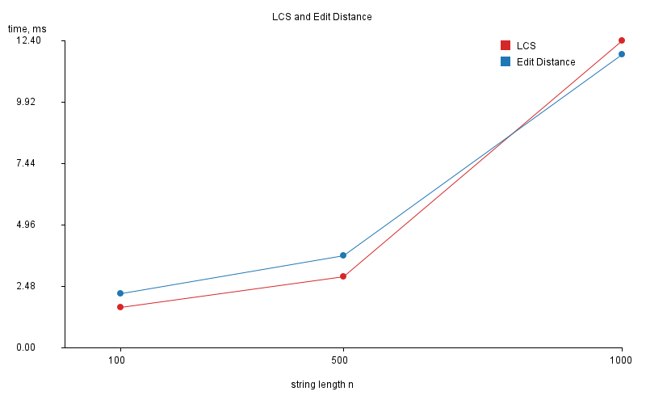
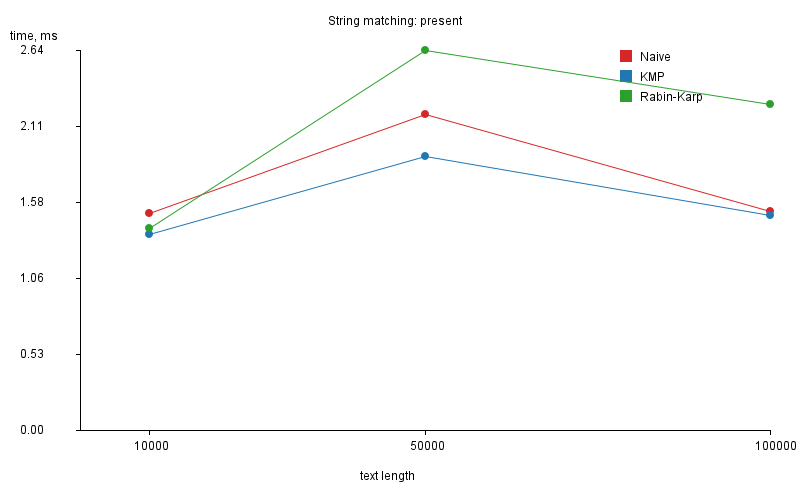
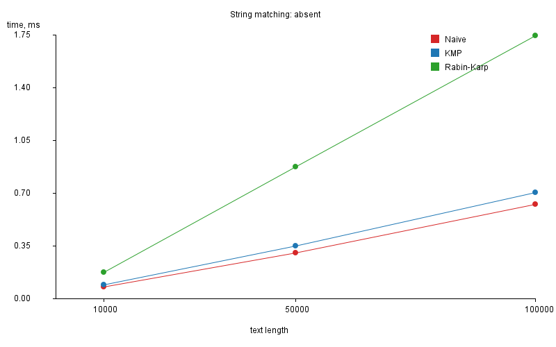
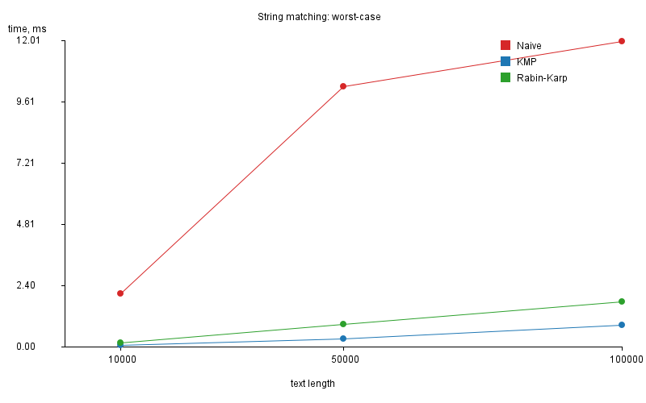
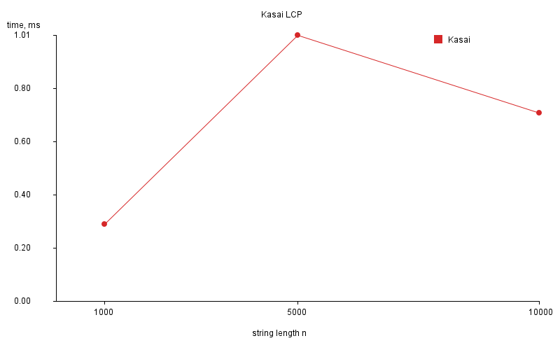

# Assignment 4 — Text Analysis: Dynamic Programming and String Algorithms

Author: Nurzhan Aisu, group SE-2530, Astana IT University

## 1. Problem description and algorithm overview

The project is a Java application that implements and compares text-analysis algorithms.

| Part | Algorithm | Purpose |
|---|---|---|
| A | LCS | Length of the longest common subsequence of two strings |
| A | Edit Distance | Minimum number of insertions, deletions and substitutions to turn one string into another |
| B | Naive matching | Baseline: compare the pattern at every position of the text |
| B | KMP | Uses the LPS (prefix) table to never move backwards in the text |
| B | Rabin-Karp | Uses a rolling hash and verifies characters only when hashes are equal |
| C | Kasai | Builds the LCP array from a string and its suffix array |

All algorithms are implemented manually, without library search or distance methods.

## 2. Implementation decisions and assumptions

- Project structure: `algorithms` (all algorithms), `util` (random generator and PNG plot writer), `app` (experiments).
- Empty pattern: all three matchers return an empty list. A pattern longer than the text also returns an empty list.
- Every matcher returns all starting indices, including overlapping ones (`aa` in `aaaaa` gives `0,1,2,3`).
- Rabin-Karp uses base 256 and modulus 1 000 000 007. When hashes are equal, the characters are compared, so a collision never produces a wrong answer.
- Matchers count character comparisons (`getComparisons()`). Rabin-Karp counts only verification comparisons and also counts hash collisions.
- Suffix array: `SuffixArray.build` is a simple sort of suffixes, used only to prepare input for Kasai. It is not timed.
- LCP array convention: `lcp[i]` is the longest common prefix of suffixes `sa[i]` and `sa[i-1]`, and `lcp[0] = 0`.
- Alphabet: `abcd`. Random seeds: 42 and 43 for the two strings, 100 and up for absent patterns.

### Recurrences

LCS:
- `dp[i][j] = dp[i-1][j-1] + 1` if `a[i-1] == b[j-1]`
- otherwise `dp[i][j] = max(dp[i-1][j], dp[i][j-1])`
- base: `dp[0][j] = dp[i][0] = 0`

The recurrence is correct because if the last characters are equal, they can always be part of an optimal common subsequence. If they differ, at least one of them is not used, so we drop one of them and take the better result.

Edit Distance:
- `dp[i][j] = dp[i-1][j-1]` if `a[i-1] == b[j-1]`
- otherwise `dp[i][j] = 1 + min(dp[i-1][j-1], dp[i-1][j], dp[i][j-1])` (substitution, deletion, insertion)
- base: `dp[i][0] = i`, `dp[0][j] = j`

The recurrence is correct because the last operation of any optimal edit sequence must be one of these three, and the rest is an optimal edit of shorter prefixes.

KMP: the LPS table stores, for each prefix of the pattern, the length of its longest proper prefix that is also a suffix. After a mismatch, the pattern index jumps to `lps[j-1]` and the text index never goes back, so no text character is compared again after a full shift.

Rabin-Karp: the hash of the next window is computed from the previous one in O(1): remove the first character, multiply by the base, add the new character. If two hashes are equal, the real characters are compared, so collisions only cost extra time.

Kasai: processes suffixes in text order. If suffix `i` has LCP `h` with its predecessor in the suffix array, then suffix `i+1` has LCP at least `h-1`. So `h` only decreases by 1 per step and increases at most `2n` times in total.

The LCP array shows how many characters in a row two neighbouring suffixes (in sorted order) share. It is used for finding repeated substrings, the longest repeated substring, and counting distinct substrings.

## 3. Complexity analysis

n = text length, m = pattern length, a = length of the first string, b = length of the second string.

| Algorithm | Main operation / recurrence | Best case | Worst case | Auxiliary space | Explanation |
|---|---|---|---|---|---|
| LCS | `dp[i][j]` from three neighbours | O(a·b) | O(a·b) | O(a·b) | Every table cell is filled once in O(1) |
| Edit Distance | `dp[i][j] = 1 + min(...)` | O(a·b) | O(a·b) | O(a·b) | Same table filling, always fully computed |
| Naive | Compare pattern at each shift | O(n) | O(n·m) | O(1) | Best: first character mismatches every time. Worst: text `aaa...a`, pattern `aaa...ab` |
| KMP | LPS table + one pass over the text | O(n + m) | O(n + m) | O(m) | LPS is built in O(m), the text index never moves back, so the search is O(n) |
| Rabin-Karp | Rolling hash + verification | O(n + m) expected | O(n·m) | O(1) | With few collisions only real matches are verified. If many hashes collide, each window is verified in O(m) |
| Kasai | Rank array + pointer `h` | O(n) | O(n) | O(n) | `h` increases at most 2n times in total because it drops by at most 1 per step |

Theoretical complexity describes how the number of operations grows. Measured time also depends on the JVM (JIT warm-up), the CPU, memory caches and the input, so measured values are only expected to follow the trend of the theory, not match it exactly.

## 4. Testing strategy and results

JUnit 5 tests are in `src/test/java/algorithms`:

- `LCSTest`: identical strings, completely different strings, empty string, general case.
- `EditDistanceTest`: identical strings, one empty string, substitution, insertion, deletion, general case.
- `MatcherTest`: pattern at the beginning, middle and end, multiple occurrences, overlapping occurrences, absent pattern, pattern longer than the text, empty pattern. Each test checks that Naive, KMP and Rabin-Karp return exactly the same list of indices. One more test checks the LPS table.
- `KasaiTest`: string `banana`.

Manual check for `banana`:

| i | sa[i] | suffix | lcp[i] |
|---|---|---|---|
| 0 | 5 | a | 0 |
| 1 | 3 | ana | 1 |
| 2 | 1 | anana | 3 |
| 3 | 0 | banana | 0 |
| 4 | 4 | na | 0 |
| 5 | 2 | nana | 2 |

Expected suffix array `[5, 3, 1, 0, 4, 2]`, expected LCP array `[0, 1, 3, 0, 0, 2]`.

Result: all tests pass (`mvn test`).

## 5. Experimental setup

- Inputs: LCS and Edit Distance, length 100, 500, 1000. String matching, text length 10 000, 50 000, 100 000 with pattern length 50. Kasai, length 1000, 5000, 10 000.
- Alphabet `abcd`, random strings with fixed seeds (`java.util.Random`).
- String matching scenarios: pattern present (taken from the middle of the text), pattern absent (random pattern verified not to occur), and worst case for Naive (text of only `a`, pattern `aaa...ab`).
- The same text and pattern are used for Naive, KMP and Rabin-Karp. The program throws an error if their results differ.
- Timing: `System.nanoTime()`, one warm-up run, then 5 timed runs, the average is reported in milliseconds.
- Input generation, suffix array construction, console output and file writing are outside the timed regions.
- Operation counts: character comparisons for string matching.

## 6. Results

<!-- Run app.Main and paste the content of results/results.md here -->

Plots:











## 7. Discussion

<!-- Compare with your own numbers after running the program -->

- LCS and Edit Distance: both fill an n×n table, so when n grows 10 times (100 to 1000) the work grows about 100 times. Their times are close because each cell does a similar amount of work.
- Naive vs KMP: on random text with a 4-letter alphabet most shifts fail after 1-2 comparisons, so Naive is close to O(n) and has a comparison count similar to KMP. On the worst-case input Naive makes about n·m comparisons while KMP makes about 2n, which matches the theory.
- Rabin-Karp: it does almost no character comparisons (only verification), but it computes a hash for every position, so on random text it is not faster than Naive or KMP in time. The comparison count and the running time measure different things.
- Kasai: the time grows roughly linearly with n.
- Small timings (below 1 ms) are noisy because of JIT compilation, so trends are more reliable than single values.

## 8. Conclusion

- LCS and Edit Distance have the same O(a·b) time and space. The tables can be reduced to two rows when only the length is needed.
- Naive is the simplest and needs no extra memory, but it has an O(n·m) worst case.
- KMP guarantees O(n + m) for any input at the cost of O(m) memory and a preprocessing step.
- Rabin-Karp is easy to extend (for example for many patterns) and fast on average, but it has an O(n·m) worst case if hashes collide often.
- Kasai builds the LCP array in linear time, but it needs the suffix array as input, and building the suffix array is the more expensive part.

## How to run

Requirements: JDK 17+ and Maven (IntelliJ IDEA has both).

```
mvn test
mvn compile
java -cp target/classes app.Main
```

In IntelliJ: open the folder as a Maven project, run `app.Main` (green arrow). Tables and plots are written to the `results` folder.
